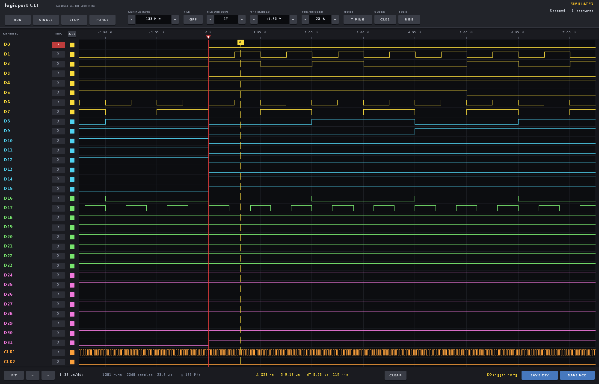

# logicport CLI

A desktop logic analyzer for the LogicPort LA1034, written in C
on the AMI tool kit. The LA1034 is a 34 channel, 500 MHz USB logic analyzer
(32 data inputs and two clock inputs) whose own software is a closed, 32 bit
Windows program. This is a replacement for that software: the window is the
instrument, since the device has no screen of its own, with the run controls
and settings across the top, the channels and their trigger conditions down
the left, the waveforms with a time axis, trigger mark and cursors across the
middle, and a readout strip along the bottom. The same program, unchanged,
builds on Linux, Mac OS X and Windows, as the other AMI instrument panels do
([mso1104](https://github.com/samiam95124/mso1104), at6301).

Not affiliated with or endorsed by Intronix Test Instruments. LogicPort is a
product name of Intronix. This program is an independent work for that
hardware: it contains no vendor code, artwork or icons, and the FPGA images
it needs are fetched from the vendor by the user (see below). `--version`
prints this notice.

The device is an FTDI FT245BL USB FIFO in front of an Altera Cyclone EP1C4
FPGA and has no firmware of its own: the FPGA is SRAM based and is loaded by
the host, through the FTDI chip in bit-bang mode, every time the analyzer is
set up. The images come from the vendor's own `LogicPort.ccf`, which this
program reads unmodified; see *The FPGA image* below.

## Build and run

    make                     # needs ~/projects/amitk built (or set AMIDIR), libusb-1.0
    ./logicport              # finds the analyzer on USB
    ./logicport --sim        # no hardware: a simulated board
    ./logicport --version    # the version and the notice above
    make sim                 # same as ./logicport --sim

The analyzer is USB device `0403:dc48` (FTDI's vendor ID, Intronix's product
ID). The program talks to it through libusb, so no kernel driver is involved
and the only setup is permission to open the device: a udev rule such as

    SUBSYSTEM=="usb", ATTR{idVendor}=="0403", ATTR{idProduct}=="dc48", MODE="0666", TAG+="uaccess"

in `/etc/udev/rules.d/99-logicport.rules`, then
`sudo udevadm control --reload && sudo udevadm trigger` or a replug. The
program looks for the analyzer every 2 s, so it can be plugged in after
starting, and it reconnects after a cable pull. On the Mac libusb comes from
Homebrew (`brew install libusb`); on Windows (MSYS2 MinGW) from pacman, and
the device has to be bound to WinUSB with Zadig, as for the mso1104 panel.

### The FPGA image

The program needs the eight FPGA images from the vendor software, which
Intronix has not licensed for redistribution, so they are not in this
repository. `vendor/` holds the extraction tool from the sigrok-util project
and the hashes; to get the file:

    make firmware            # needs python3 and 7-Zip (brew install sevenzip on the Mac)

runs `vendor/sigrok-fwextract-intronix-logicport --download`, which fetches
`logicport_2371.exe` (4.8 MB) from pctestinstruments.com and writes
`vendor/intronix-logicport.ccf` (8.4 MB, sha256 `9298a5ea…`), which is where
the program looks first. Or copy that file from a machine that has it. It also looks in the current directory, in
`vendor/` next to the executable, in `~/.local/share/sigrok-firmware` and
`/usr/share/sigrok-firmware` (where a sigrok install of the same driver would
put it), and at `$LOGICPORT_CCF`. Without the file the analyzer is found and
opened but the status says so and nothing can be captured.

## Using it

| Control | Action |
|---|---|
| RUN | Capture again and again (lit green while running) |
| SINGLE | One capture, then stop |
| STOP | Stop; a capture in progress is abandoned |
| FORCE | Trigger now (lit amber while armed and waiting) |
| SAMPLE RATE | 1 kHz to 500 MHz in 1-2-5 steps. 500 MHz is double data rate and does not allow RLE |
| RLE | Compression: memory holds transitions instead of samples, so a slow bus fits. Up to 200 MHz |
| RLE WINDOW | With RLE, how long to wait: the pre- and post-trigger fills are bounded in time by this many samples at the sample rate, since an idle input never fills the memory |
| THRESHOLD | Input logic threshold, -6 V to +6 V in 50 mV steps. Click the value to cycle presets: 1.50 (TTL), 1.65 (3.3 V CMOS), 1.25, 0.90 (1.8 V), 2.50 (5 V CMOS) |
| PRE-TRIGGER | How much of the 2048 entry memory is kept before the trigger, in 5 % steps |
| MODE | TIMING samples at the sample rate; STATE samples on an external clock on CLK1 or CLK2 |
| CLOCK, EDGE | State mode: which clock input and which edge |
| Channel name | Click to rename; type, then Enter (or Esc). Names are kept in `~/.logicportrc` |
| Trigger box | Cycle the channel's trigger condition: X (don't care), 0, 1, / (rising), \\ (falling), \| (either edge). Levels and edges on different channels combine: an edge while the pattern holds |
| Square | Take the channel out of the display and out of the RLE compression (a floating input otherwise fills the memory with its noise). ALL / 8 toggles all channels or just D0-D7 |
| Waveforms | Wheel zooms about the pointer, drag pans, click sets cursor A, right click cursor B |
| FIT, +, - | Fit the capture to the window, zoom in and out |
| SAVE CSV, SAVE VCD | Save the capture to `~/Desktop/LogicPort_<date>_<time>.csv` or `.vcd` |

The wheel over any setting steps it. The readout strip shows the time per
division, the capture (runs, samples, span, compression, rate), and the two
cursors with their difference and its frequency.

Keyboard: `r` run, `s` single, space stop, `t` force, `f` fit, `+`/`-` zoom,
Left/Right pan, `a`/`b` put a cursor at the pointer, `c` clear the cursors,
`x` save CSV, `v` save VCD, Up/Down sample rate, PgUp/PgDn threshold.

Settings are saved in `~/.logicportrc` on exit and when a name is changed.

The simulator (`--sim`) makes up a board: a UART on D0 at 115200 sending a
message, an SPI bus on D1-D3, an I2C bus on D4-D5, a byte counter on
D6-D13, square waves on D14-D17 and a 25 MHz clock on CLK1, at the chosen
sample rate and honouring the trigger, pre-trigger and RLE settings.

## How the analyzer works

The protocol was worked out by two independent efforts in 2026, which this
program follows: the libsigrok driver by Miguel Angel Ajo Pelayo (libsigrok
pull request 315, closed unmerged by a maintainer in October 2026, so not in
any sigrok release) and the EmbeddedAndroid/stimulus daemon, whose protocol
notes cross check the driver. Nothing comes from Intronix, who published no
protocol or SDK.

**Transport.** The FT245BL is driven with libusb directly: its vendor control
requests (reset and purge, latency timer, baud divisor, bit-bang mode, pin
read, EEPROM read) and two bulk endpoints. Every 64 byte packet from the chip
starts with two modem status bytes, stripped here. The EEPROM user area holds
a signed decimal calibration offset for the threshold DAC.

**Configuration.** The FPGA is loaded over the FTDI pins in bit-bang mode as
Altera passive serial: nCONFIG low then high, wait for nSTATUS, stream the
image (two bytes per bit, DCLK low then high) in 10000 byte chunks, wait for
CONF_DONE, a few extra clocks. `LogicPort.ccf` is a text line of nine XOR
obfuscated decimal numbers (eight image sizes and their XOR) followed by the
images, each a ready bit-bang stream with its first two 4 KiB blocks swapped.
There is an image per sampling mode: timing up to 250 MHz, timing at 500 MHz
(DDR), and six for state mode (sampling on, before or after the clock edge);
the program uses three of them and reloads only when the mode changes. The
loaded image can be read back, so a warm start skips the load.

**Registers.** A command is five bytes, opcode, 16 bit offset, 16 bit count
minus one, then write data; the reply is the opcode and a 16 bit sequence
number, then read data. Opcode `C3` selects the upper half of a 32 bit
address, `C1` writes, `C2` reads. The sequence number survives in the FPGA
between sessions, so every open floods it with zeros and a `01` to reset the
parser. Sample memory is 2048 entries of 40 bits: four lanes of D0-D31 and a
flags lane with the clocks; with compression an entry flagged as a count
holds a 35 bit number of unchanged sample periods instead. The trigger has
two levels (A, then B) of pattern, edge masks, counts and durations; this
program uses level A with a pattern and an edge mask.

**A capture.** Settings are written in the vendor's order: prescaler and
1-2-5 step, clock mode, compression mask, trigger level, threshold DAC (which
then needs 200 ms to settle), the pre and post trigger depths. RUN then ARM
starts it. The status register says when the pre-fill is done, when the
trigger fired, and when the capture is complete; with RLE the fills are ended
by the host when their time is up. Readout is the five lanes from the ring
buffer's write pointer, and the trigger position register locates the
trigger, allowing for the trigger pipeline delay (7 samples, 21 in DDR).

## Files

- `logicport.c`: the panel (drawing, input, settings file, export).
- `la.c`, `la.h`: the USB link, FPGA configuration, acquisition, readout, the
  link thread and the simulator; CSV and VCD export.
- `vendor/`: the sigrok-util extraction tool, hashes, and the vendor
  installer, help files and extracted image once fetched (not committed).
- `NOTES.md`: hardware details of this unit and the state of the upstream
  projects.
- `panel.png`: the panel on the simulated board, taken with the test build.
- `make shot` builds `logicport_shot`, a test version that photographs its
  own window (`LOGICPORT_SHOT=<file>`) and runs scripted clicks
  (`LOGICPORT_SCRIPT=RATE+,COND0,SINGLE` at 1 s, `LOGICPORT_SCRIPT2=CSV` at
  2.5 s, the picture at `LOGICPORT_SHOT_MS`). `LOGICPORT_TRACE=1` logs the
  link to stderr in either build.

## License

BSD 3-clause, see [LICENSE](LICENSE), the same terms as the AMI tool kit.
The one exception is `vendor/sigrok-fwextract-intronix-logicport`, which is
from the sigrok-util project and stays under its own GPL v3 license.

## What is not done

- The second trigger level (A then B), occurrence counts, durations and
  value ranges, which the hardware has.
- Per channel input inversion, the hardware frequency counter and the live
  input activity readout.
- Protocol decoders. Save the capture as VCD and open it in PulseView or
  GTKWave for that.
- State mode and the 500 MHz DDR mode follow the sigrok driver and have been
  exercised less than timing mode on this unit.
